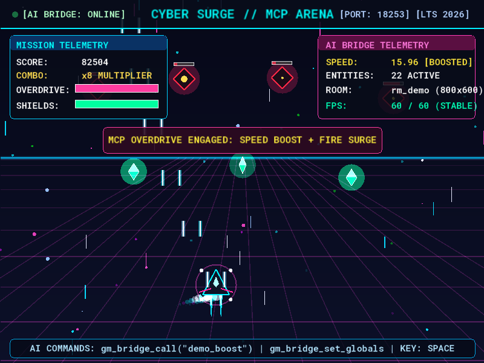

<div align="center">

# 🎮 gamemaker-mcp

**Give any AI model direct access to your GameMaker projects — inspect and edit them, build & run them, and control the game live while it plays.**

An [MCP](https://modelcontextprotocol.io) server for **GameMaker** (LTS 2026 / 2024.x on macOS) that works with **Claude, GPT, Gemini and any other model** your MCP client supports.

[](https://nodejs.org)
[](https://modelcontextprotocol.io)
[](LICENSE)
[]()



*Captured by a model through `gm_bridge_screenshot`, mid-game. The HUD shows values the model changed over the bridge **while the game was running**: speed 3 → 9 and a boost triggered by a simulated key press.*

</div>

---

## ✨ What it does

**52 MCP tools** in three layers:

| Layer | You get |
| --- | --- |
| 🗂 **Project** | Read/write scripts, objects + every event type, rooms, instances, room/instance creation code, sprites imported from PNGs, raw `.yy` JSON, full-text GML search — all in GameMaker's own file format |
| 🔨 **Build & run** | Compile with the official **Igor** CLI (structured errors with file + line), launch the game, stop it, tail run logs, read captured runtime errors |
| 🕹 **Live game** | While the game runs: read/write globals & instance variables, create/destroy instances, switch rooms, call any GML function, simulate key presses, slow motion, read bridge logs — and **screenshots returned as images the model can literally see** |

Works with any MCP-capable client — **Claude Desktop / Claude Code, Cline, Cursor, Windsurf, VS Code Copilot, Zed, Continue, Gemini CLI, Codex CLI** — and with remote/web agents through the built-in **streamable HTTP** transport.

> **Model-agnostic by design.** Your AI host does the tool calling; the server just answers MCP. Anything from Claude to GPT to Gemini to a local Llama works as long as the host supports tools.

---

## 🚀 Quick start

**Requirements:** macOS · Node.js ≥ 20 · GameMaker installed and logged in at least once.

```sh
git clone https://github.com/mehdivijeh/gamemaker-mcp.git ~/gamemaker-mcp
cd ~/gamemaker-mcp
npm install
node test/mcp-handshake.mjs   # self-check (no GameMaker needed)
```

Register the server in your client — e.g. **Claude Desktop**
(`~/Library/Application Support/Claude/claude_desktop_config.json`):

```json
{
  "mcpServers": {
    "gamemaker": {
      "command": "node",
      "args": ["/Users/YOU/gamemaker-mcp/src/index.js"]
    }
  }
}
```

or with **Cline** (VS Code / CLI): `cline mcp add gamemaker -- node ~/gamemaker-mcp/src/index.js`

→ **Every client, with exact paths: [`docs/clients.md`](docs/clients.md)**

Restart your client, then just ask:

> *"Using the gamemaker tools: list my projects, open MyGame, run it and screenshot it."*

---

## 🔌 Three ways to run it

| Mode | Command | Use for |
| --- | --- | --- |
| **stdio** *(default)* | `node src/index.js` | local clients that spawn the server (Claude Desktop, Cline, Cursor, …) |
| **streamable HTTP** | `node src/index.js --http 8737` | remote-capable clients, web agents, containers, other machines on your LAN — endpoint `http://127.0.0.1:8737/mcp` |
| **as a library / scripted** | `import … from "gamemaker-mcp/src/…"` | automation — see [`demo/mcp-demo.mjs`](demo/mcp-demo.mjs), which drives the server end-to-end |

`node src/index.js --help` shows all options. Everything is auto-detected (Igor, runtime, licence, projects folder) — check with the `gm_runtime_info` tool, or pin manually via `~/.gamemaker-mcp.json` / `GAMEMAKER_*` env vars.
## 🧰 Tool overview

<details open>
<summary><b>Project & code</b> — no GameMaker process needed</summary>

| Tool | Purpose |
| --- | --- |
| `gm_runtime_info` | detected Igor / runtimes / user folder / projects / bridge port |
| `gm_list_projects` · `gm_open_project` · `gm_create_project` · `gm_close_project` · `gm_project_summary` | find, open, create, close & summarize projects |
| `gm_list_resources` · `gm_read_resource` | browse resources & raw `.yy` JSON |
| `gm_search_gml` · `gm_read_gml` · `gm_write_gml` | regex search, read/write GML (scripts or any object event) |
| `gm_create_script` | new script resource |
| `gm_create_object` · `gm_get_object` · `gm_set_object_properties` · `gm_list_object_events` · `gm_set_object_event` · `gm_remove_object_event` | objects, properties (sprite, parent, flags) & all events |
| `gm_create_room` · `gm_get_room` · `gm_set_room_properties` · `gm_set_first_room` · `gm_list_room_instances` · `gm_add_instance` · `gm_remove_instance` · `gm_set_room_creation_code` | rooms, dimensions, order, instances, creation code |
| `gm_import_sprite` | sprite from PNG frame(s) with the modern frame/layer/sequence layout |
| `gm_delete_resource` | remove a resource (folder + project entry) |

</details>

<details open>
<summary><b>Build & run</b> — Igor CLI</summary>

| Tool | Purpose |
| --- | --- |
| `gm_build` | release build; returns structured compile errors, stats, output paths (auto-retries Igor's flaky .NET crash) |
| `gm_run_game` | build (optional) + stage + launch + auto-connect the live bridge |
| `gm_stop_game` · `gm_read_game_log` · `gm_read_runtime_error` | lifecycle & diagnostics |

</details>

<details open>
<summary><b>Live game bridge</b> — while the game runs</summary>

| Tool | Purpose |
| --- | --- |
| `gm_inject_bridge` | add the in-game bridge (once per project, idempotent) |
| `gm_bridge_info` | room, fps, sizes, instance count, mouse coords, save area |
| `gm_bridge_get_globals` / `gm_bridge_set_globals` | read & write globals (numbers, strings, arrays, structs) |
| `gm_bridge_list_instances` / `gm_bridge_get_instance` / `gm_bridge_set_instance` | inspect & modify instances live |
| `gm_bridge_create_instance` / `gm_bridge_destroy_instance` | spawn/remove instances at runtime |
| `gm_bridge_change_room` · `gm_bridge_restart_room` · `gm_bridge_restart_game` · `gm_bridge_call` | `room_goto` / restart room or game / call any GML function by name |
| `gm_bridge_eval` | evaluate GML strings (needs `__mcp_eval`/`execute_string` in the game) |
| `gm_bridge_key` · `gm_bridge_set_mouse` | simulate keys (`space`, `right`, `A`, `F5`, …) & window mouse position |
| `gm_bridge_set_speed` | fps / slow motion |
| `gm_bridge_logs` | in-game bridge log (connections, custom `mcp_bridge_log()`, exceptions) |
| `gm_bridge_screenshot` | PNG of the game window, returned as an image to the model |

</details>

→ **Full reference with every parameter: [`docs/tools.md`](docs/tools.md)**

---

## 💬 Example prompts

- *"List my GameMaker projects, open Cover Assault, find the player's jump code, add coyote time, build and run."*
- *"Start the game. Show me every `obj_enemy` with `hp < 50`, set their hp to 0 and screenshot the result."*
- *"Hold the right arrow for 2 seconds, then tell me how far the player moved."* — automated play-testing
- *"The player falls through the floor. Read the captured runtime error, find the bug, fix it, rebuild and verify live."*
- *"Import `~/Downloads/coin_*.png` as `spr_coin` at 12 fps and give it to `obj_coin`."*
- *"Create `rm_boss` (1024×768), load it when `global.score > 100`, and jump there live to test it."*

---

## 🔬 How it works

```
 AI client (Claude Desktop / Cline / Cursor / web agent ...)
        │  MCP: stdio  or  streamable HTTP
        ▼
 gamemaker-mcp (Node)
   ├── project layer ──► .yyp / .yy / .gml files on disk            (edit anything)
   ├── igor layer    ──► <runtime>/bin/igor/.../Igor mac Compile    (build)
   │                      staged into "YoYo Runner.app" + launched  (run)
   └── bridge layer  ──► tcp 127.0.0.1:18253, newline JSON          (live control)
                             ▲
                    the running game: mcp_bridge script + obj_mcp_bridge
```

- **Project layer** — GameMaker projects are plain files (`.yyp` + `.yy` JSON + `.gml`). The server reads/writes them with a tolerant parser for GameMaker's *relaxed JSON* and templates verified against real projects and Igor builds.
- **Build layer** — wraps Igor with the flags that actually work on macOS, auto-retries a flaky .NET `AccessViolationException`, parses compile errors, and stages the game into the runner app (which is what the IDE does under the hood).
- **Live layer** — `gm_inject_bridge` adds a **pure-GML bridge** (one script + one persistent invisible object, ~450 lines) that opens a raw TCP server inside your game and speaks newline-delimited JSON. No third-party libraries, no runtime patches. Delete the two resources before shipping.

Curious about the gory details? GameMaker's undocumented TCP login handshake, async-event ids, save-area quirks, reference formats, the Igor bug — all documented in **[`docs/internals.md`](docs/internals.md)** and **[`docs/protocol.md`](docs/protocol.md)**.
## 🎬 The live demo

```sh
node demo/mcp-demo.mjs
```

creates a fresh project at `~/GameMakerProjects/MCP Demo` **entirely through the MCP tools**, builds and launches it, then drives it live (globals, function calls, teleport, injected keys, 3 screenshots) and stops it. The screenshots in this README are its output.

---

## 🧪 Tests & development

```sh
npm test                     # 24 unit tests — no GameMaker required
node test/mcp-handshake.mjs  # MCP protocol handshake (42 tools, error handling)
node test/http.test.mjs      # streamable HTTP transport + session handling
node test/e2e-gamemaker.mjs  # full loop against a real install: build → run → live → stop
node test/debug-run.mjs      # build + launch and leave the game running for manual poking
```

Everything is plain ESM JavaScript — no build step. Layout:

```
src/     project.js creators.js events.js igor.js bridge.js config.js yy.js index.js
gml/     mcp_bridge.gml + events/*.gml   (the in-game bridge source that gets injected)
test/    unit tests, protocol tests, e2e, helpers
demo/    mcp-demo.mjs (end-to-end showcase)
docs/    clients.md tools.md usage.md protocol.md internals.md troubleshooting.md
```

---

## 🔐 Security

- **The live bridge has no authentication** (GameMaker limitation) and can read/write any variable in your game. It is a **development tool** — remove `mcp_bridge` + `obj_mcp_bridge` (or ask the AI to) before shipping a build.
- The **HTTP transport binds to `127.0.0.1` by default**; set `GAMEMAKER_MCP_HTTP_HOST` only on trusted networks.
- The server only touches your GameMaker projects, runs *your* Igor, and talks to games *you* launched locally.

---

## 🩺 Troubleshooting

| Symptom | Fix |
| --- | --- |
| "No project open" | call `gm_open_project` first, or pin `project` in `~/.gamemaker-mcp.json` |
| "Not connected to a running game" | `gm_run_game` first; make sure `gm_inject_bridge` ran **before** the build |
| Bridge not responding | `gm_read_game_log` — if it shows a GML compile error, fix and re-run |
| Wrong runtime detected | pin `runtimePath` (check with `gm_runtime_info`) |
| First `gm_run_game` is slow | first build stages the YoYo Runner app (~30 s), then it's fast |

More: **[`docs/troubleshooting.md`](docs/troubleshooting.md)**

---

## 🤝 Contributing

PRs and issues are welcome — see [CONTRIBUTING.md](CONTRIBUTING.md). Good first projects: Windows/Linux Igor support, collision events, sprite-sheet slicing, an `__mcp_eval` wrapper script, HTTP auth.

---

## 📄 License

[MIT](LICENSE) © 2026 Mehdi Vijeh.

GameMaker is a trademark of **YoYo Games Ltd.** This project is unofficial and is not affiliated with or endorsed by YoYo Games.
